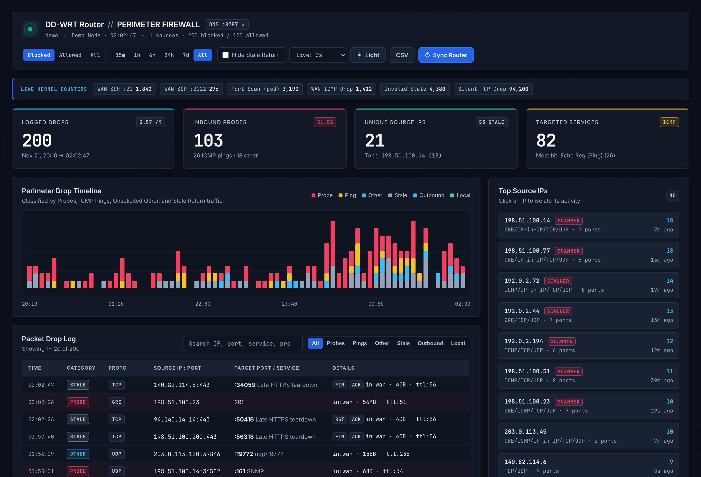
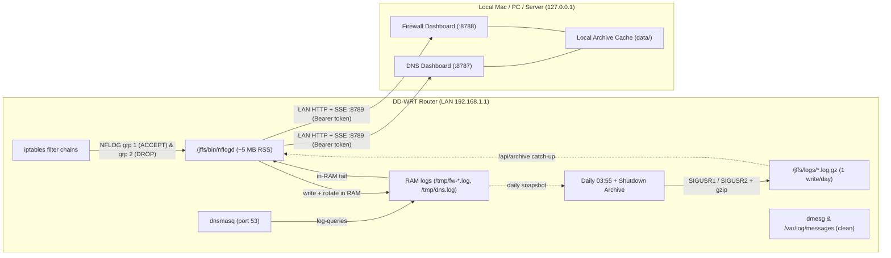
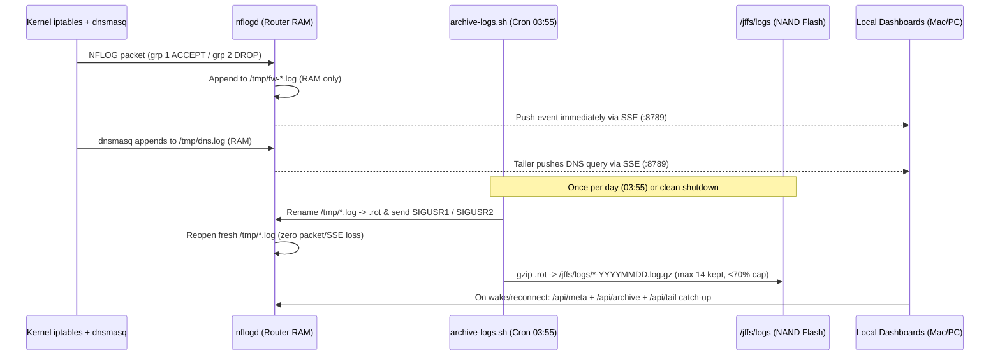

# DD-WRT Telemetry

[](https://github.com/synthable/ddwrt-telemetry/actions/workflows/ci.yml)
[](https://github.com/synthable/ddwrt-telemetry/releases)
[](LICENSE)
[](nflogd/go.mod)
[](dns-dashboard/server.py)
[](#architecture)
[](DESIGN.md)

Zero-dependency, real-time **DNS** and **Perimeter Firewall** dashboards for DD-WRT routers — powered by a lightweight Go `NFLOG` daemon (`nflogd`) that **completely bypasses `dmesg` and `/var/log/messages`** and streams live events over LAN Server-Sent Events (SSE).

No Docker. No `npm`. No Entware or USB drive required. Pure Go stdlib + Python 3 stdlib + vanilla HTML/CSS/JS with dark & light modes.

---

## Screenshots

### DNS Telemetry Dashboard (`:8787`)
<picture>
  <source media="(prefers-color-scheme: light)" srcset="docs/dns-dashboard-light.png">
  <source media="(prefers-color-scheme: dark)" srcset="docs/dns-dashboard.png">
  
</picture>

### Perimeter Firewall Dashboard (`:8788`)
<picture>
  <source media="(prefers-color-scheme: light)" srcset="docs/firewall-dashboard-light.png">
  <source media="(prefers-color-scheme: dark)" srcset="docs/firewall-dashboard.png">
  
</picture>

*(Captured in `--demo` mode with synthetic data. Both dashboards include a Dark/Light theme toggle and match GitHub's color scheme above.)*

---

## Try It Immediately (Demo Mode)

No router required — launch **both** dashboards together with one command:

```bash
make demo
```

Then open:
- **DNS Telemetry**: http://127.0.0.1:8787
- **Perimeter Firewall**: http://127.0.0.1:8788

Press `Ctrl+C` to stop both cleanly (or run individually via `make demo-dns` / `make demo-fw`).

---

## Why This Exists

1. **DD-WRT firewall logging floods `dmesg` and wipes syslog**: Enabling `log_accepted` or `log_dropped` writes straight to the kernel ring buffer and BusyBox `syslogd`'s 200 KB RAM buffer, overwriting Wi-Fi (`hostapd`), SSH (`dropbear`), and kernel alerts within minutes. Stock DD-WRT's BusyBox `syslogd` ignores `/etc/syslog.conf` and doesn't ship `ulogd`.
2. **Kernel `NFLOG` is already compiled into DD-WRT**: Routing `iptables` log chains to `NFLOG` groups sends packets directly to a tiny userspace netlink reader in RAM — leaving `dmesg` and `/var/log/messages` 100% clean.
3. **Per-LAN-device DNS visibility without cloud caps or heavy router proxies**: Logging `dnsmasq` queries to RAM (`/tmp/dns.log`) with daily compressed archival to `/jffs/logs/` gives per-device query stats and AdGuard Public DNS (`0.0.0.0` / `::`) block tracking with zero ongoing NAND flash wear and no 5-device / 300k-query cloud limits.

---

## Architecture



### Log Lifecycle & Flash-Safe Rotation



---

## Features

### DNS Telemetry Dashboard (`:8787`)
- **Per-LAN-device matrix**: resolves client IPs to hostnames from `/tmp/dnsmasq.conf` (`dhcp-host`) and `/jffs/dnsmasq.leases`. Click any device to isolate its queries, block rate, cache hit rate, top domains, and timeline.
- **AdGuard Public DNS block detection**: separates null-routed `0.0.0.0` / `::` blocks from `Cached`, `Allowed`, and `NXDOMAIN` replies, correlating concurrent `A`, `AAAA`, `HTTPS`, and reverse `PTR` lookups.
- **Interactive filtering**: time ranges (`15m`–`7d`, `All`), `Hide PTR` toggle, instant search, record-type chips, live SSE updates, Dark/Light mode toggle, and CSV export.

### Perimeter Firewall Dashboard (`:8788`)
- **Dual `Blocked` + `Allowed` views (IPv4 `iptables`)**: inspect both unsolicited WAN `DROP`/`REJECT`/`portscan` hits and `NEW` accepted outbound/LAN flows with resolved LAN device names. *(Note: the supplied `router-scripts/rc_firewall.sh` instruments IPv4 `iptables` chains only; IPv6 `ip6tables` rules are not wired into `NFLOG` by default.)*
- **Heuristic traffic classification + view-only `Hide Stale Return` toggle**: labels packets heuristically from ports, protocols, and TCP flags into `Probe` (e.g. RDP `3389`, Memcached `11211`, SNMP `161`, SIP `5060`, IPMI `623`, raw GRE `47` / IP-in-IP `4`, TCP `SYN`), `Ping`, `Other`, and `Stale Return` (late `UDP/443|80|53` and TCP `RST`/`FIN`/`ACK` teardown packets). Enabling **Hide Stale Return** only hides inferred stale drops from the active view — all underlying raw events remain stored and accessible when unchecked.
- **Auto-detected WAN interface & live kernel `iptables` counters**: `nflogd` detects the default egress interface (`ip route show default`, e.g., `wan`, `eth0`, `vlan2`, `ppp0`) and exposes it via `/api/meta` (override with `--wan-iface` / `WAN_IFACE`). Displays packet counts for matched silent `DROP` rules and shows `N/A` when a rule or interface counter is unavailable rather than reporting `0`.
- **Exact deduplication** across overlapping live and archived logs, plus local archive persistence under `data/archives/`.

### `nflogd` Router Daemon
- Pure Go standard library — compiles to a single static binary (`armv7`, `arm64`, `mipsle`) with embedded timezone data (`time/tzdata`).
- RAM-first ring files (`/tmp/fw-accept.log` capped at 8 MB, `/tmp/fw-drop.log` capped at 4 MB) + `SIGUSR1` reopen on rotation.
- LAN-only HTTP/SSE server bound strictly to your router's LAN IP with constant-time Bearer token auth.

---

## Router Installation (DD-WRT)

### Option A: Automated Preflight & Deploy Script

```bash
# 1. Dry-run preflight (checks architecture, kernel nfnetlink_log, and /jffs space)
./scripts/install-router.sh --router root@192.168.1.1 --ssh-port 2222 --ssh-key ~/.ssh/id_ed25519_router --dry-run

# 2. Build (if needed), generate Bearer token, and deploy to /jffs
./scripts/install-router.sh --router root@192.168.1.1 --ssh-port 2222 --ssh-key ~/.ssh/id_ed25519_router
```

*(The script never overwrites your existing `rc_startup` or `rc_firewall` NVRAM scripts — it uploads `/jffs/bin/nflogd`, `/jffs/etc/nflogd.token`, and `/jffs/scripts/archive-logs.sh`, then prints the hooks to merge.)*

### Option B: Manual Build & Deploy

1. **Build `nflogd`** (or download a prebuilt binary from [GitHub Releases](../../releases)):
   ```bash
   make build-armv7   # Linksys WRT1900ACv2 / WRT3200ACM / ARMv7
   # or: make build-arm64 | make build-mipsle
   ```
2. **Generate a shared Bearer token**:
   ```bash
   mkdir -p ~/.ddwrt && chmod 700 ~/.ddwrt
   python3 -c "import os, secrets; p=os.path.expanduser('~/.ddwrt/nflogd.token'); open(p,'w').write(secrets.token_hex(32)+'\n'); os.chmod(p, 0o600)"
   ```
3. **Upload to `/jffs`** and merge the templates in [`router-scripts/`](router-scripts/):
   - **Startup** (`rc_startup`): [`router-scripts/rc_startup.sh`](router-scripts/rc_startup.sh) (adjust `-tz` and `-http-listen` if needed)
   - **Firewall** (`rc_firewall`): [`router-scripts/rc_firewall.sh`](router-scripts/rc_firewall.sh) *(IPv4 `iptables` only; verifies `nfnetlink_log` + `NFLOG` support before touching chains, preserves custom rules without flushing, and supports `rc_firewall.sh rollback`)*
   - **Shutdown** (`rc_shutdown`): `/jffs/scripts/archive-logs.sh >/dev/null 2>&1`
   - **Additional Dnsmasq Options** (`dnsmasq_options`): [`router-scripts/dnsmasq_options.conf`](router-scripts/dnsmasq_options.conf)
   - **Cron Jobs** (`cron_jobs`): [`router-scripts/cron_jobs.txt`](router-scripts/cron_jobs.txt)
   - Set `log_accepted=0` in DD-WRT Security → Log so stock kernel `LOG` rules aren't emitted alongside `NFLOG`.
4. **Launch both local dashboards**:
   ```bash
   make run
   # or with custom name / router API / local archive retention:
   ./scripts/run-dashboards.sh --router-name "WRT1900ACv2" --api http://192.168.1.1:8789 --retain-days 30
   ```

   **Local Archive Retention** (both dashboards):
   - `--retain-days N` / `RETAIN_DAYS=N` (default: `30`, `0` disables): prunes managed local archives under `data/archives/` older than `N` days and skips re-downloading expired router archives.
   - `--max-archives N` / `MAX_ARCHIVES=N` (default: `0` / unlimited): caps the number of newest managed local archives kept per log prefix (`dns`, `fw-drop`, `fw-accept`, `syslog`). Unrelated files in `data/archives/` are never deleted.

---

## Tested Hardware

| Router | Firmware | CPU Arch | Kernel | `nflogd` RSS | Status |
| --- | --- | --- | --- | --- | --- |
| Linksys WRT1900ACv2 | DD-WRT v3.0-r62036 std | `armv7l` | `6.1.147-rt28` | ~5.3 MB | Verified |

*Tested on another router or DD-WRT/OpenWrt build? PRs adding to this table are welcome.*

---

## `nflogd` HTTP/SSE API

All endpoints require `Authorization: Bearer <token>` and listen only on the configured LAN IP:

| Endpoint | Purpose |
| --- | --- |
| `GET /api/health` | Daemon PID, uptime, live file sizes & inodes |
| `GET /api/stream?types=dns,drop,accept` | Real-time Server-Sent Events push stream |
| `GET /api/tail?file=dns\|drop\|accept&offset=N&inode=I` | Incremental byte-offset delta fetch |
| `GET /api/meta` | `dnsmasq.conf`, DHCP leases, live `iptables` counters, archive list |
| `GET /api/archive?name=<file>.log.gz` | Download archived `.log.gz` from `/jffs/logs/` |

---

## Design, Accessibility & Security

- **Design System & WCAG 2.1 AA**: Documented in [DESIGN.md](DESIGN.md) (Enterprise SOC Dark + Light tokens, keyboard navigation, ARIA landmarks/roles, and accessible chart summaries).
- **Security Policy & Threat Model**: See [SECURITY.md](SECURITY.md).

## Development & Tests

```bash
make test       # Go tests, Python unit tests, JS & shell syntax checks
make build-all  # Cross-compile armv7, arm64, mipsle
```

## License

[MIT](LICENSE)
