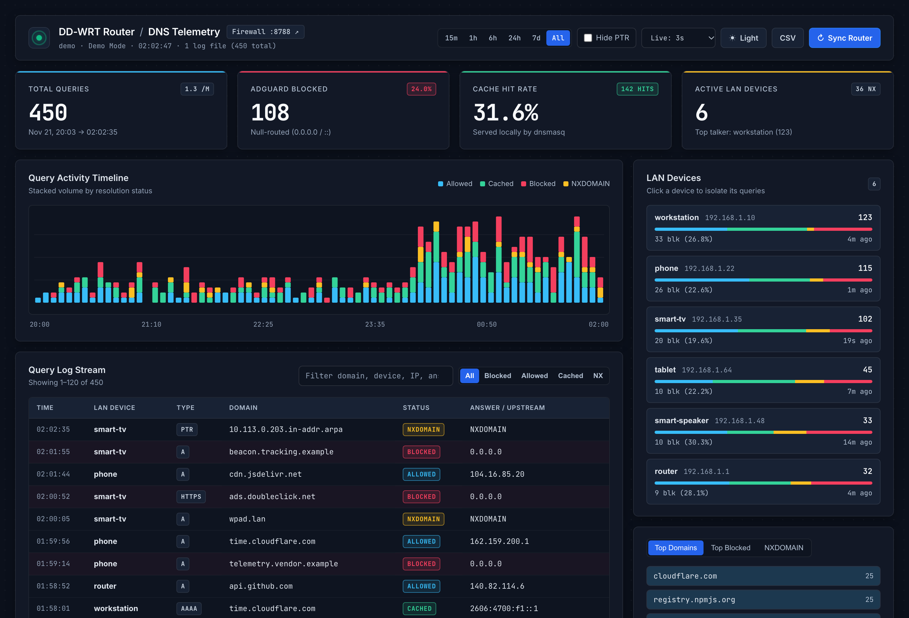
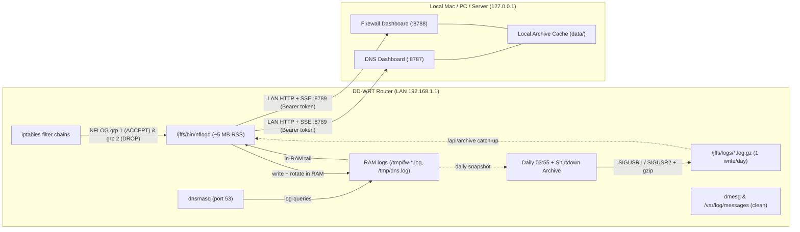
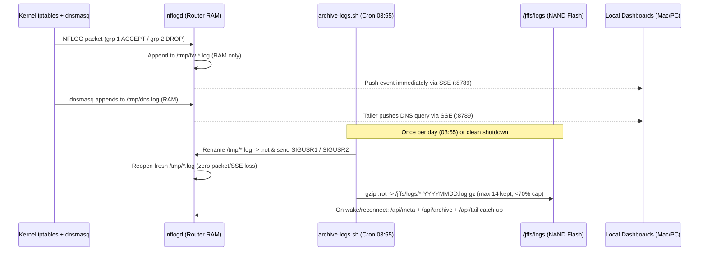

# DD-WRT Telemetry

Zero-dependency, real-time **DNS** and **Perimeter Firewall** dashboards for DD-WRT routers — powered by a lightweight Go `NFLOG` daemon (`nflogd`) that **completely bypasses `dmesg` and `/var/log/messages`** and streams live events over LAN Server-Sent Events (SSE).

No Docker. No `npm`. No Entware or USB drive required. Pure Go stdlib + Python 3 stdlib + vanilla HTML/CSS/JS.

---

## Screenshots

### DNS Telemetry Dashboard (`:8787`)


### Perimeter Firewall Dashboard (`:8788`)


*(Captured in `--demo` mode with synthetic data.)*

---

## Why This Exists

1. **DD-WRT firewall logging floods `dmesg` and wipes syslog**: Enabling `log_accepted` or `log_dropped` writes straight to the kernel ring buffer and BusyBox `syslogd`'s 200 KB RAM buffer, overwriting Wi-Fi (`hostapd`), SSH (`dropbear`), and kernel alerts within minutes. Stock DD-WRT's BusyBox `syslogd` ignores `/etc/syslog.conf` and doesn't ship `ulogd`.
2. **Kernel `NFLOG` is already compiled into DD-WRT**: Routing `iptables` log chains to `NFLOG` groups sends packets directly to a tiny userspace netlink reader in RAM — leaving `dmesg` and `/var/log/messages` 100% clean.
3. **Per-LAN-device DNS visibility without cloud caps or heavy router proxies**: Logging `dnsmasq` queries to RAM (`/tmp/dns.log`) with daily compressed archival to `/jffs/logs/` gives per-device query stats and AdGuard Public DNS (`0.0.0.0` / `::`) block tracking with zero ongoing NAND flash wear and no 5-device / 300k-query cloud limits.

---

## Architecture



### Log Lifecycle & Flash-Safe Rotation



---

## Try It Immediately (Demo Mode)

No router required — spin up both dashboards with synthetic LAN + WAN telemetry:

```bash
# Terminal 1 — DNS Dashboard (http://127.0.0.1:8787)
make demo-dns

# Terminal 2 — Firewall Dashboard (http://127.0.0.1:8788)
make demo-fw
```

---

## Features

### DNS Telemetry Dashboard (`:8787`)
- **Per-LAN-device matrix**: automatically resolves client IPs to hostnames from `/tmp/dnsmasq.conf` (`dhcp-host`) and `/jffs/dnsmasq.leases`. Click any device to isolate its queries, block rate, cache hit rate, top domains, and timeline.
- **AdGuard Public DNS block detection**: separates null-routed `0.0.0.0` / `::` blocks from `Cached`, `Allowed`, and `NXDOMAIN` replies, with smart correlation across concurrent `A`, `AAAA`, `HTTPS`, and reverse `PTR` lookups.
- **Interactive filtering**: time ranges (`15m`–`7d`, `All`), `Hide PTR` toggle, instant search, record-type chips, live SSE updates, and CSV export.

### Perimeter Firewall Dashboard (`:8788`)
- **Dual `Blocked` + `Allowed` views**: inspect both unsolicited WAN `DROP`/`REJECT`/`portscan` hits and `NEW` accepted outbound/LAN flows (with LAN device names!).
- **Automatic traffic classification + `Hide Stale Return` toggle**: separates genuine inbound probes (RDP `3389`, Memcached `11211`, SNMP `161`, SIP `5060`, IPMI `623`, raw GRE `47` / IP-in-IP `4`) and ICMP pings from harmless late QUIC (`UDP/443`) and TCP `RST` teardown noise.
- **Live kernel `iptables` counters**: surfaces packet counts even for silent `DROP` rules (WAN SSH `:22`/`:2222`, `psd` port-scan drops, silent catch-all TCP drops).
- **Exact deduplication** across overlapping live and archived logs, plus local archive persistence under `data/archives/`.

### `nflogd` Router Daemon
- Pure Go standard library — compiles to a single static binary (`armv7`, `arm64`, `mipsle`) with embedded timezone data (`time/tzdata`).
- RAM-first ring files (`/tmp/fw-accept.log` capped at 8 MB, `/tmp/fw-drop.log` capped at 4 MB) + `SIGUSR1` reopen on rotation.
- LAN-only HTTP/SSE server bound strictly to your router's LAN IP with constant-time Bearer token auth.

---

## Router Installation (DD-WRT)

### 1. Cross-compile `nflogd` for your router CPU

```bash
# Linksys WRT1900ACv2 / WRT3200ACM / ARMv7 routers
make build-armv7

# Or ARM64 / MIPS little-endian
make build-arm64
make build-mipsle
```

*(Requires Go 1.22+ on your build machine.)*

### 2. Generate a shared Bearer token

```bash
mkdir -p ~/.ddwrt && chmod 700 ~/.ddwrt
python3 -c "import os, secrets; p=os.path.expanduser('~/.ddwrt/nflogd.token'); open(p,'w').write(secrets.token_hex(32)+'\n'); os.chmod(p, 0o600)"
```

### 3. Deploy to `/jffs` on your router

```bash
ROUTER="root@192.168.1.1"
SSH_OPTS="-p 2222 -i ~/.ssh/id_ed25519_router"

ssh $SSH_OPTS $ROUTER 'mkdir -p /jffs/bin /jffs/etc /jffs/scripts /jffs/logs && chmod 700 /jffs/etc'
ssh $SSH_OPTS $ROUTER 'cat > /jffs/etc/nflogd.token && chmod 600 /jffs/etc/nflogd.token' < ~/.ddwrt/nflogd.token
ssh $SSH_OPTS $ROUTER 'cat > /jffs/bin/nflogd && chmod 755 /jffs/bin/nflogd' < nflogd/dist/nflogd-armv7
ssh $SSH_OPTS $ROUTER 'cat > /jffs/scripts/archive-logs.sh && chmod 755 /jffs/scripts/archive-logs.sh' < router-scripts/archive-logs.sh
```

### 4. Configure DD-WRT hooks

Apply the templates in [`router-scripts/`](router-scripts/) via the DD-WRT web UI (or `nvram set` + `nvram commit`):
- **Startup** (`rc_startup`): [`router-scripts/rc_startup.sh`](router-scripts/rc_startup.sh) (update `-tz` and `-http-listen` if needed)
- **Firewall** (`rc_firewall`): [`router-scripts/rc_firewall.sh`](router-scripts/rc_firewall.sh)
- **Shutdown** (`rc_shutdown`): `/jffs/scripts/archive-logs.sh >/dev/null 2>&1`
- **Additional Dnsmasq Options** (`dnsmasq_options`): [`router-scripts/dnsmasq_options.conf`](router-scripts/dnsmasq_options.conf)
- **Cron Jobs** (`cron_jobs`): [`router-scripts/cron_jobs.txt`](router-scripts/cron_jobs.txt)
- Disable `log_accepted=0` in DD-WRT Security → Log so stock kernel `LOG` rules aren't emitted alongside `NFLOG`.

### 5. Run the local dashboards

```bash
# Terminal 1 — DNS Dashboard (http://127.0.0.1:8787)
python3 dns-dashboard/server.py --router-name "My Router"

# Terminal 2 — Firewall Dashboard (http://127.0.0.1:8788)
python3 firewall-dashboard/server.py --router-name "My Router"
```

Common flags:
- `--api http://192.168.1.1:8789` (or `ROUTER_API` env var)
- `--token-file ~/.ddwrt/nflogd.token` (or `ROUTER_TOKEN_FILE` env var)
- `--router-name "WRT1900ACv2"` (or `ROUTER_NAME` env var)
- `--demo` (synthetic demo mode, no router needed)

---

## `nflogd` HTTP/SSE API

All endpoints require `Authorization: Bearer <token>` and listen only on the configured LAN IP:

| Endpoint | Purpose |
| --- | --- |
| `GET /api/health` | Daemon PID, uptime, live file sizes & inodes |
| `GET /api/stream?types=dns,drop,accept` | Real-time Server-Sent Events push stream |
| `GET /api/tail?file=dns\|drop\|accept&offset=N&inode=I` | Incremental byte-offset delta fetch |
| `GET /api/meta` | `dnsmasq.conf`, DHCP leases, live `iptables` counters, archive list |
| `GET /api/archive?name=<file>.log.gz` | Download archived `.log.gz` from `/jffs/logs/` |

---

## Security Notes

- **LAN-only binding**: `nflogd` binds strictly to `192.168.1.1:8789` (never `0.0.0.0`), and DD-WRT's `INPUT` chain drops unsolicited WAN traffic. If the token file is missing or empty, the HTTP API refuses to start.
- **Plaintext HTTP on trusted LAN**: The router API uses HTTP (not TLS) with a 256-bit Bearer token to keep the router daemon tiny and dependency-free. This is appropriate on a trusted home LAN; do not expose port `8789` to WAN or untrusted guest VLANs.
- **Local dashboards bind to `127.0.0.1` only** by default.
- **Flash longevity**: Live logs write exclusively to RAM (`/tmp`), with a single compressed daily write to `/jffs/logs/` plus a hard `70%` `/jffs` capacity guard.

---

## Development & Tests

```bash
make test
```

## License

[MIT](LICENSE)
